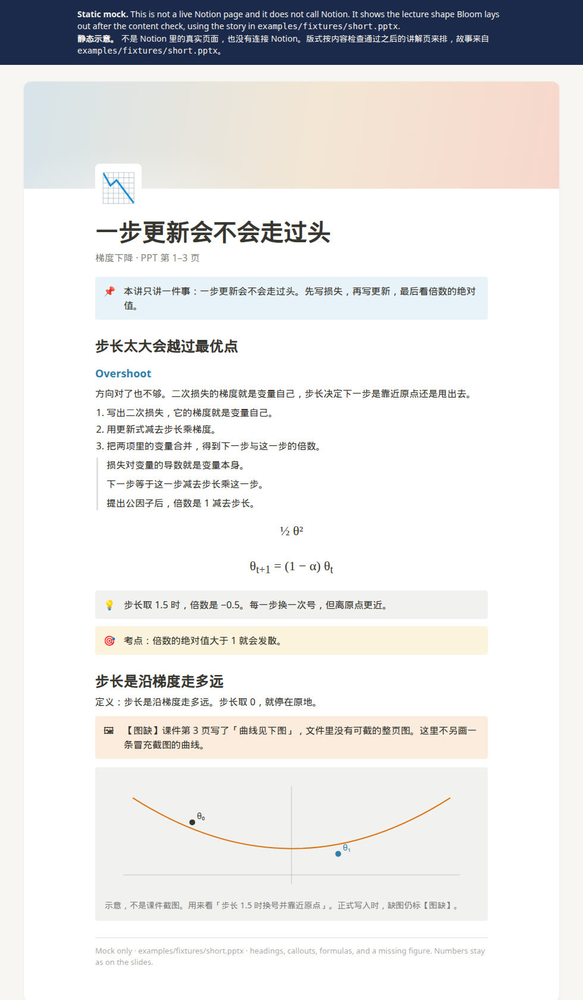

# Static demo

[English](../../README.md) · [中文](../../README.zh-CN.md)

Open [index.html](index.html) in a browser. GitHub shows that file as source; the page itself does not need a build, a server, or a Notion account.

It is a **mock** of the lecture page Bloom would lay out after the content check, using [examples/fixtures/short.pptx](../../examples/fixtures/short.pptx). It is not a live Notion integration.

## 静态演示

用浏览器打开 [index.html](index.html)。GitHub 上打开这个文件看到的是源码。页面不需要构建、服务器，也不需要 Notion 账号。

这是内容检查通过之后，Bloom 会排出来的讲解页**示意**，故事来自 [examples/fixtures/short.pptx](../../examples/fixtures/short.pptx)。不是 Notion 里的真实页面。
